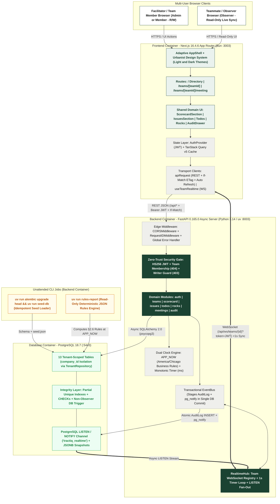
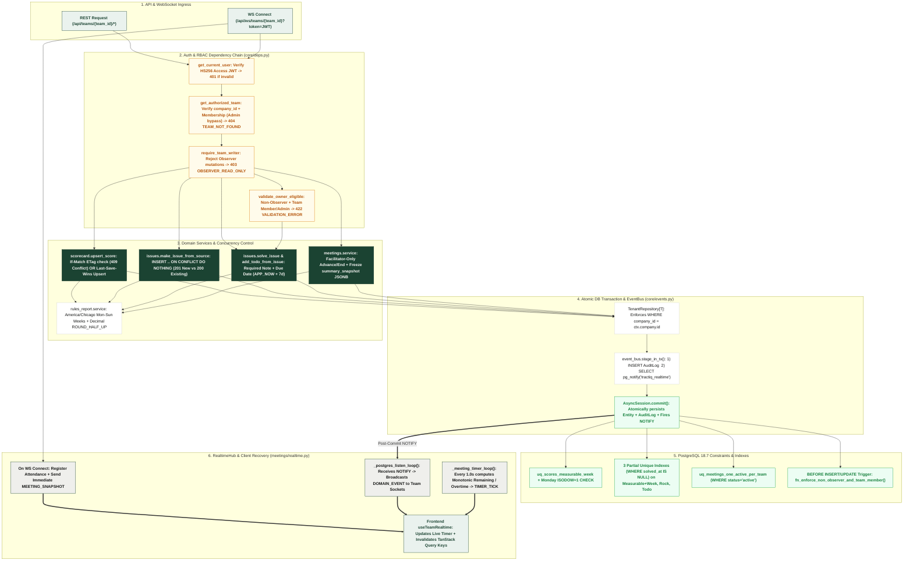
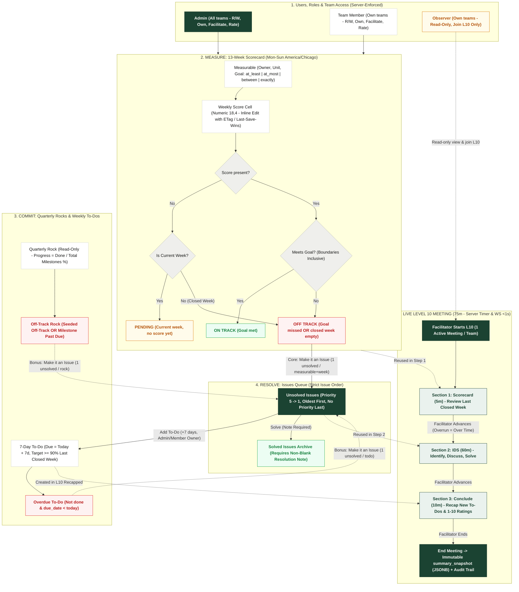
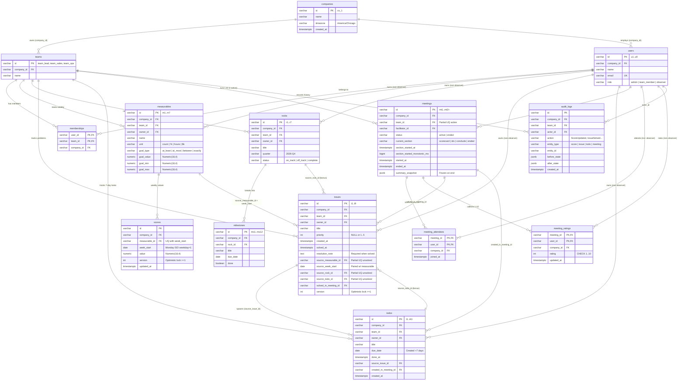

# TracTiq — Architecture & Domain Diagrams

This document catalogs the system architecture, low-level execution pipeline, EOS weekly workflow, and PostgreSQL schema for **TracTiq**. Every diagram below is rendered inline via **Mermaid**.

| # | Diagram                                                                                | Scope                                                                                                                            |
| :- | :------------------------------------------------------------------------------------- | :------------------------------------------------------------------------------------------------------------------------------- |
| 1 | [High-Level Design (HLD)](#1-high-level-design-hld)                                     | Containers, Next.js frontend, FastAPI backend, WebSocket pub/sub, CLI jobs, and PostgreSQL 18.7                                  |
| 2 | [Low-Level Design (LLD)](#2-low-level-design-lld)                                       | RBAC dependency chain, optimistic concurrency, zero-duplicate upsert, transactional `EventBus`, and `RealtimeHub` loops      |
| 3 | [EOS Domain &amp; Scoring Workflow](#3-eos-domain--weekly-scoring-workflow)             | Weekly `America/Chicago` Scorecard rules, `Make it an Issue` links, Issues/To-Dos/Rocks loop, and 75-minute Level 10 Meeting |
| 4 | [Database Entity-Relationship (ER) Diagram](#4-database-entity-relationship-er-diagram) | All 13 tenant-scoped PostgreSQL tables, primary/foreign keys, partial unique indexes, and DB triggers                            |

---

## 1. High-Level Design (HLD)

Shows the three-container runtime topology (`frontend :3003`, `backend :8003`, `db :5443`), dual-protocol client communication (authenticated REST with `ETag`/`If-Match` + `< 1s` WebSocket sync), deterministic `APP_NOW` vs. monotonic meeting timer separation, and unattended CLI entrypoints (`seed-db` and `rules-report`).

---

## 2. Low-Level Design (LLD)

Traces how an incoming REST mutation or WebSocket connection flows through FastAPI's authorization dependency chain (`core/deps.py`), concurrency-safe service logic (`If-Match` optimistic locking + `ON CONFLICT DO NOTHING` atomic deduplication), `TenantRepository` scoping, single-transaction `AuditLog` + `pg_notify` staging (`core/events.py`), and `RealtimeHub` (`meetings/realtime.py`) WebSocket state recovery (`MEETING_SNAPSHOT`, `DOMAIN_EVENT`, and `1.0s` `TIMER_TICK`).

---

## 3. EOS Domain & Weekly Scoring Workflow

Illustrates the repeating weekly **Measure → Commit → Resolve** loop: how weekly Measurable scores evaluate to `On Track`, `Off Track`, or `Pending` across all four goal types (`at_least`, `at_most`, `between`, `exactly`), how off-track Scorecard cells, off-track Rocks, and overdue To-Dos escalate into deduplicated **Issues**, how solving Issues spawns `+7 day` **To-Dos**, and how the 75-minute **Level 10 Meeting** (`Scorecard 5m → IDS 60m → Conclude 10m`) reuses the workspace modules and freezes an immutable summary snapshot.

---

## 4. Database Entity-Relationship (ER) Diagram

Documents all 13 PostgreSQL tables defined in `backend/alembic/versions/0001_initial_schema.py`, including `company_id` tenant scoping, explicit source-linking foreign keys (`source_measurable_id` + `source_week_start`, `source_rock_id`, `source_todo_id`, `source_issue_id`), partial unique indexes preventing duplicate unsolved Issues and concurrent active meetings, `CHECK` constraints, and the `fn_enforce_non_observer_and_team_member` database trigger.

